# Agentic AI for Information Retrieval: A Comparative Analysis of Static Hybrid RAG and Dynamic Wikipedia Crawling Frameworks


## 1. Executive Summary & System Overview

Modern Information Retrieval (IR) is undergoing a paradigm shift driven by autonomous AI agents. While traditional Retrieval-Augmented Generation (RAG) frameworks rely on a static, linear pipeline—embedding a query once, retrieving top-k chunks, and feeding them to a Large Language Model (LLM)—they struggle when confronted with complex, multi-step information requirements. Real-world information needs often require multi-hop reasoning across disparate documents, comparative entity evaluation, or dynamic ambiguity resolution through interactive user dialogue.

This project delivers a comprehensive comparative analysis and implementation of two distinct agentic information retrieval architectures:

1. **Static Closed-Domain Hybrid RAG System:** A parallelized hybrid retrieval architecture operating over a pre-indexed offline corpus (WikiText-103). It combines dense semantic vector search (`BAAI/bge-base-en-v1.5` in FAISS), sparse lexical search (`BM25Okapi` with NLTK tokenization), Reciprocal Rank Fusion (RRF), and Cross-Encoder neural reranking (`ms-marco-MiniLM-L-6-v2`).
2. **Dynamic Open-Domain Wikipedia Agent:** An autonomous crawling agent operating directly over the live Wikipedia REST API. It utilizes an Observe-Plan-Act-Validate loop, localized micro-RAG for real-time HTML context compression, deterministic link-following state filters, and self-correcting query rewrite mechanisms.

### Core Engineering Motivations & Contributions

* **Strict Local LLM Adherence:** A primary pillar of this project is demonstrating how small, open-weights language models (**Qwen 3.5 9B**), when governed by structured prompting and deterministic Python orchestration, can execute complex cognitive workflows without relying on proprietary cloud APIs (e.g., OpenAI) or massive GPU infrastructure. The entire pipeline executes locally on consumer hardware (AMD Radeon RX 6900XT 16GB via Vulkan backend + Intel Core i5 14400F + 32GB DDR4 RAM), ensuring 100% data privacy and zero API monetary cost.
* **The Agentic RAG Trilemma:** The empirical evaluation formally defines and validates the trade-offs between **Latency**, **Compute/Cost**, and **Data Freshness**. Static local indexing maximizes execution speed and cost predictability at the expense of data freshness, while dynamic web crawling delivers real-time data freshness at the cost of high network I/O latency and API rate-limiting bottlenecks.
* **Deterministic Guardrails over LLM Volatility:** To prevent hallucinations, infinite execution loops, and context window pollution, all state management, link filtering, dependency substitution (`{previous_result}`), and rate-limit backoffs are managed by deterministic Python control logic rather than relying solely on LLM decision-making.

---

## 2. System Architecture & Component Topology

The system is engineered around three core architectural principles:

1. **Separation of Concerns:** Modular subagents handle dedicated tasks (intent extraction, strategy drafting, localized retrieval, evidence evaluation, and answer synthesis).
2. **Deterministic Control Layer:** Python execution loops strictly govern state transitions, URL deduplication, multi-hop placeholder replacement, and rate-limiting.
3. **Iterative Refinement:** Subagents dynamically request clarification when queries are underspecified or rewrite search queries when evidence is insufficient.

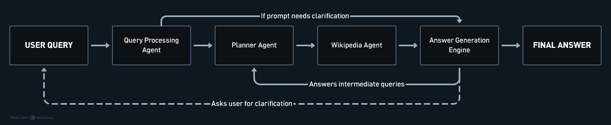

*Figure 1: High-Level System Architecture Topology showing the Observe-Plan-Act-Validate control flow across the Query Handler, DAG Planner, Control Layer, and dual retrieval engines.*

---

## 3. Comprehensive Module & Codebase Mapping

```
.
├── main.py                          # Main entry point & orchestrator for Dynamic Wikipedia Agent
├── main_rag.py                      # Main entry point & orchestrator for Static Hybrid RAG
├── main_logger.py                   # Centralized logging & execution trace recorder (wiki-data.log)
├── requirements.txt                 # Project dependency manifests
├── Ingestion/
│   ├── preprocess_wikitext.py       # Regex hierarchy parser & section dictionary builder
│   └── chunk_and_index.py           # Recursive text chunker, FAISS dense & BM25 sparse index builder
├── Query_Planner/
│   ├── query_handler.py             # Intent/Entity extractor & stateful multi-turn clarification loop
│   └── planner.py                   # DAG retrieval planning engine & {previous_result} dependency solver
├── RAG/
│   └── rag_tool.py                  # ThreadPool-parallelized RAGTool class (FAISS, BM25, RRF, Cross-Encoder)
├── LLM_Module/
│   ├── llm_router.py                # Model-agnostic provider abstraction layer (LM Studio vs OpenRouter)
│   ├── lm_studio_server.py          # Local LM Studio API client (Vulkan/GPU accelerated)
│   ├── open_router_server.py        # Cloud API fallback client
│   └── prompt_templates.py          # Few-shot prompts for all cognitive subagents
└── Evaluation_Agent/
    ├── benchmark_runner.py          # Automated 2WikiMultiHopQA benchmark execution harness
    └── ragas_eval.py                # LLM-as-a-judge scoring engine (RAGAS-inspired metrics)
```

---

## 4. Deep-Dive Component Specifications

### 4.1 Query Handler (`Query_Planner/query_handler.py`)

The Query Handler functions as the cognitive front door. Its goal is to parse user intent, evaluate query sufficiency, and produce a structured JSON representation.

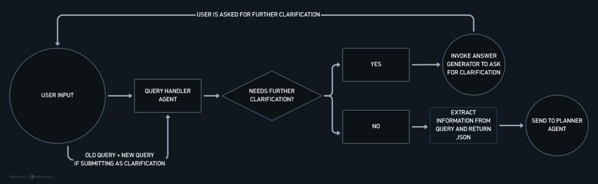

*Figure 2: Query Handler Execution Flowchart detailing query validation, stateful clarification loop handling (up to 3 iterations), and structured JSON intent extraction.*

* **Stateful Ambiguity Resolution:** When a query is ambiguous (e.g., *"Who was he fighting against?"*), the Handler sets `"status": "clarification_required"`. The Answer Generator presents a polite follow-up. When the user responds (e.g., *"Napoleon"*), the Handler maintains conversational history, combining the prior query and new input. Without state maintenance, isolated inputs like *"Napoleon"* cannot be parsed.
* **Hard Termination Cap:** The clarification loop is capped at a maximum of 3 iterations via Python control code to eliminate perpetual clarification traps.
* **Few-Shot JSON Extraction Schema:**
  ```json
  {
    "intent": "Identify opponents of Napoleon Bonaparte",
    "entities": ["Napoleon Bonaparte"],
    "concepts": ["European History", "19th Century Coalitions"],
    "relationships": [
      {"subject": "Napoleon Bonaparte", "object": "Opposing Coalitions", "relationship": "fought against"}
    ],
    "query": "Who was Napoleon Bonaparte fighting against?",
    "status": "ready"
  }
  ```

---

### 4.2 Planner Agent (`Query_Planner/planner.py`)

The Planner receives the Query Handler's JSON payload and drafts an executable, directed acyclic graph (DAG) retrieval plan.

#### Upfront Non-Recursive Strategy & Dynamic Dependencies
Rather than re-planning recursively at every step, the Planner generates the complete strategy upfront. For multi-hop questions (e.g., *"Where was the current President of Italy born?"*), the Planner introduces explicit `depends_on` arrays and dynamic `{previous_result}` seed query placeholders.

```json
{
  "objectives": [
    {
      "objective": "Identify the current President of Italy.",
      "depends_on": [],
      "seed_queries": ["Current President of Italy"]
    },
    {
      "objective": "Determine the birthplace of the individual identified in Objective 1.",
      "depends_on": [1],
      "seed_queries": ["{previous_result} birthplace"]
    }
  ]
}
```

#### Deterministic Control Layer Execution

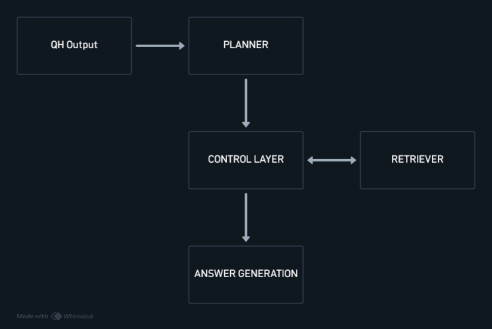

*Figure 3a: Streamlined Single-Objective Answer Generation Workflow.*

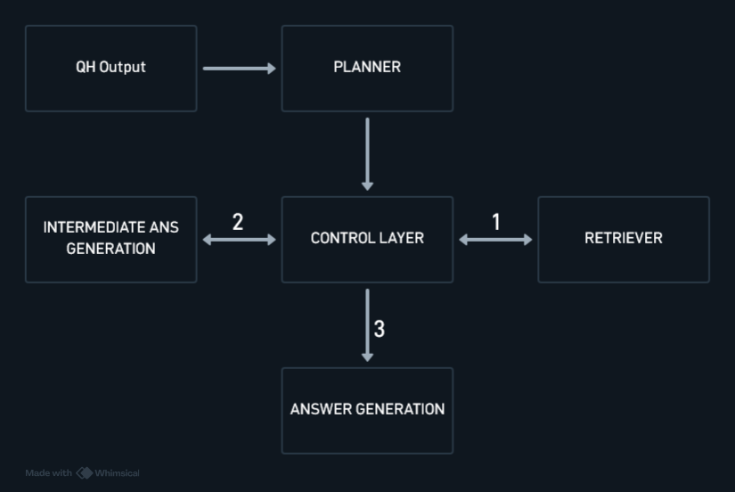

*Figure 3b: Multi-Objective Answer Generation Architecture with sequential dependency resolution and dynamic `{previous_result}` string substitution.*

1. **Objective 1 Execution:** Control layer passes `"Current President of Italy"` to the active Retriever tool.
2. **Intermediate Fact Extraction:** Evidence is routed to `generate_intermediate_result()`, which uses low-temperature prompting to extract only the core entity string (*"Sergio Mattarella"*).
3. **String Replacement:** Python replaces `{previous_result}` in Objective 2's seed query, producing `"Sergio Mattarella birthplace"`.
4. **Objective 2 Execution & Synthesis:** Retriever executes the resolved query, and all evidence is merged for final synthesis.

---

### 4.3 Static Hybrid RAG Pipeline (`RAG/rag_tool.py` & `Ingestion/`)

The Static RAG pipeline operates on an offline vector and lexical index constructed from the WikiText-103 dataset.

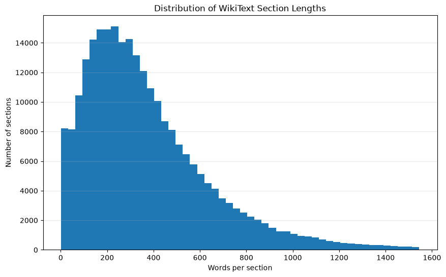

*Figure 4a: Histogram of WikiText-103 section word counts demonstrating the 1,000-word chunking limit rationale.*

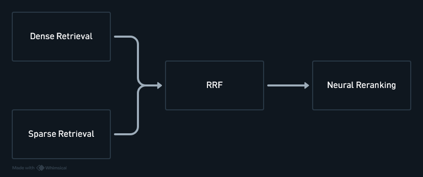

*Figure 4b: Static Hybrid RAG Retrieval Pipeline integrating parallel FAISS dense search, BM25 sparse search, Reciprocal Rank Fusion, and Cross-Encoder neural reranking.*

#### A. Corpus Preprocessing & Structural Hierarchy Parsing
* **Corpus Unification:** Kaggle WikiText-103 train, test, and validation subsets were combined into a continuous corpus of **29,558 articles**.
* **Regex Hierarchy Parsing:** Articles were split along natural formatting delimiters (`= TOPIC =`, `== SUBTOPIC ==`, `=== SUBHEADING ===`). Storing section text alongside hierarchy metadata produced **256,982 structured section dictionaries**:
  ```json
  {
    "title": "Robert Boulter",
    "sub_topic": "Career",
    "sub_heading": "2000 – 2005",
    "text": "Boulter began his career..."
  }
  ```
* **Statistical Length Analysis & Chunking:** Section word counts revealed a mean of 388.4 words, with **95% of sections containing fewer than 1,000 words**. A 1,000-word limit was applied. Sections under 1,000 words were indexed intact; the remaining ~5% were split using LangChain's `RecursiveCharacterTextSplitter`, yielding **270,296 total chunks**.

#### B. Hybrid Dual-Vector Indexing
* **Dense Semantic Index:** Chunks were encoded into 768-dimensional dense embeddings using `BAAI/bge-base-en-v1.5` executing locally on Vulkan GPU architecture and stored in a **FAISS** vector index.
* **Sparse Lexical Index:** Text was tokenized via NLTK (preventing punctuation/capitalization splits, e.g., *"Richard"* vs. *"Richard's"*) and indexed using **BM25Okapi** (persisted as pickle objects).

#### C. Fusion & Cross-Encoder Reranking
* **Reciprocal Rank Fusion (RRF):** Merges dense similarity dot-products and probabilistic BM25 scores without hyperparameter scaling fragility:
  $$\text{RRF\_Score}(d) = \sum_{m \in \{\text{dense}, \text{sparse}\}} \frac{1}{k + \text{rank}_m(d)}$$
  With $k = 60$. Documents ranking highly in both semantic and lexical lists naturally bubble to the top.
* **Neural Cross-Encoder Reranking:** Top RRF candidates are passed to `ms-marco-MiniLM-L-6-v2`. The cross-encoder evaluates query and candidate tokens together using full cross-attention, filtering out "fool's gold" (documents containing matching keywords but lacking answerability).
* **ThreadPool Concurrency:** Index loading (~16s startup) and dual-path execution (Dense + Sparse) are parallelized via `ThreadPoolExecutor`, drastically cutting retrieval latency.

---

### 4.4 Dynamic Wikipedia REST API Agent (`main.py` & Subagents)

The Wikipedia Agent operates without a static index, scraping live open-web pages in real-time via an **Observe-Plan-Act-Validate** loop.

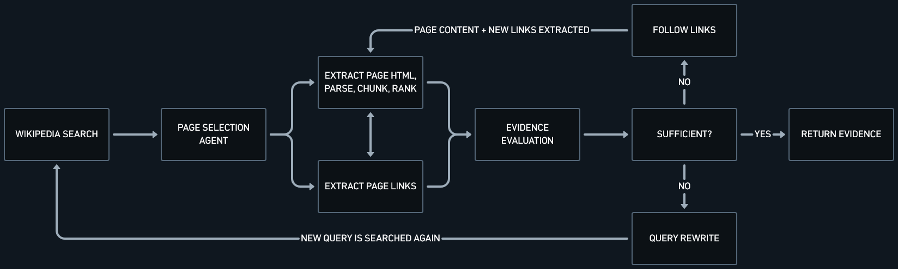

*Figure 5: Dynamic Wikipedia Agent Observe-Plan-Act-Validate execution loop illustrating live REST API search, HTML stripping, localized micro-RAG compression, evidence evaluation, link following, and self-correcting query rewriting.*

#### A. Real-Time HTML Scraping & Localized Micro-RAG
Raw Wikipedia HTML articles frequently exceed 20,000 tokens. Supplying 5 full articles directly to an LLM induces token budget explosions, crippling latency, and "Lost in the Middle" context degradation.
The agent implements an **ephemeral micro-RAG pipeline**:
1. Scrapes page HTML via BeautifulSoup4, stripping non-content tags (`<script>`, `<style>`, `nav`, *"See also"*, *"References"*).
2. Dynamically chunks clean text into 1,000-word sections.
3. Builds a temporary BM25 index to rank and extract the top 20 chunks (*Recall@k*).
4. Reranks chunks via `ms-marco-MiniLM-L-6-v2` cross-encoder to select the top 5 highest-precision evidence chunks (*Precision@k*) for LLM evaluation.

#### B. Autonomous Link Following & Visited Link Filtering
Up to 30 internal wiki-links are extracted per page. If retrieved evidence is judged insufficient by the **Evidence Evaluation Subagent**, the agent can follow up to 5 links per pass across a maximum of 3 iterations.
* **Deterministic Visited Links Filter:** A Python set tracks all visited page titles. Before candidate links are presented to the LLM, visited links are purged, preventing cyclic bouncing (e.g., *"Wars of the Roses"* <-> *"Richard III"*).
* **Query Rewrite Subagent:** If link traversal yields poor evidence, the Query Rewrite subagent reformulates search terms. Conversational memory is preserved exclusively for rewrites to prevent repeated search queries.

#### C. API Etiquette & Rate Limit Management
* Mandatory custom `User-Agent` headers on all REST requests.
* Sequential API requests with enforced inter-request delay timers.
* Exponential backoff with maximum 3 retries, dynamically parsing `Retry-After` HTTP headers.

---

### 4.5 Answer Generation Engine & Provider Abstraction (`LLM_Module/`)

* **Stateless Generation Functions:**
  1. `generate_final_answer()`: Synthesizes final answers anchored strictly to retrieved evidence payloads.
  2. `request_clarification()`: Crafts polite contextual questions when triggered by the Query Handler.
  3. `generate_intermediate_result()`: Low-temperature extraction of minimal factual strings to resolve Planner dependencies.
* **LLM Provider Abstraction Layer (`llm_router.py`):** Isolates application code from inference backends. Toggling `GLOBAL_PROVIDER` hot-swaps between:
  * `lm_studio_server` (Local GPU endpoint at `localhost:1234`, 100% private).
  * `open_router_server` (Cloud API fallback).

---

## 5. Local LLM Prompt Engineering & Guardrails

Operating complex multi-agent workflows on a 9B local model (Qwen 3.5) requires strict prompt engineering standards:

* **Few-Shot Structuring:** All cognitive subagents (Query Handler, Planner, Reranker, Evidence Evaluator) utilize explicit few-shot input/output examples within their prompt templates to enforce JSON output validity.
* **Low-Temperature Calibration:** Informational extraction functions (`generate_intermediate_result`, JSON parsing) execute at T=0.0 to ensure deterministic, reproducible outputs. Final answer synthesis executes at T=0.2.
* **Anti-Hallucination Guardrails:** The Answer Generation Engine is strictly instructed:  
  *"Synthesize your response using ONLY the facts provided in the evidence payload. If the evidence is insufficient or missing, explicitly state that the information is unavailable. Do NOT use parametric memory."*  
  This guardrail resulted in **Answer Faithfulness scores exceeding 0.82** across both pipelines.

---

## 6. Evaluation Framework & Methodology

Both systems were benchmarked against the first 100 questions of the **2WikiMultiHopQA dataset** (sourced from HuggingFace), designed to test complex multi-hop reasoning across four distinct categories:

1. **Bridge Comparison:** Comparing two entities where required facts must be retrieved through an intermediate objective (e.g., *"Who was born before: the author of The Lord of the Rings or the drummer of The Beatles?"*).
2. **Comparison:** Comparing attributes/characteristics across two entities.
3. **Compositional:** Synthesizing multiple facts to reach a single answer (e.g., *"Where was the current President of Italy born?"*).
4. **Inference:** Extracting conclusions not explicitly written as a single fact.

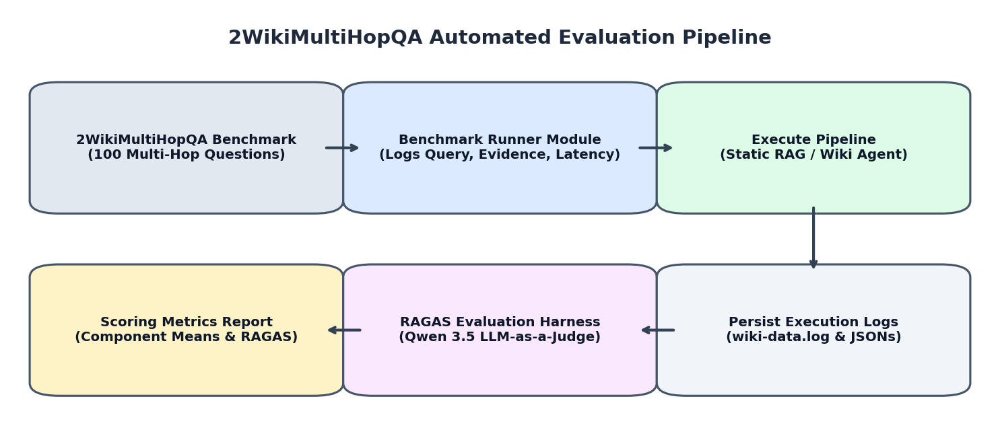

*Figure 6: Automated Benchmark Execution and RAGAS LLM-as-a-Judge Evaluation Framework Pipeline.*

---

## 7. Comprehensive Benchmarks & Metric Analysis

### 7.1 Component Mean Scores (0.0 to 1.0 Scale)

| Pipeline Component | Static Hybrid RAG | Dynamic Wikipedia Agent | Relative Performance Delta |
| :--- | :---: | :---: | :---: |
| **Query Handler** | **0.898** | 0.897 | -0.1% (Identical reasoning baseline) |
| **Planner** | 0.722 | **0.796** | **+10.2%** (Improved DAG decomposition) |
| **Evidence Retrieval** | **0.075** | **0.586** | **+681.3% (7.8x Improvement)** |
| **Answer Generation** | 0.620 | **0.744** | **+20.0%** (Higher grounded accuracy) |

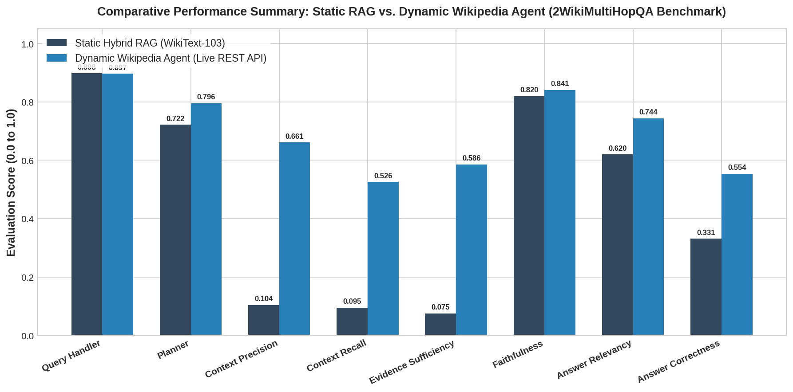

*Figure 7a: Comprehensive empirical comparison between Static Hybrid RAG and Dynamic Wikipedia Agent across component and end-to-end evaluation metrics.*

---

### 7.2 Detailed RAGAS Evaluation Metrics

| Metric | Static Hybrid RAG | Dynamic Wikipedia Agent | Empirical Interpretation |
| :--- | :---: | :---: | :--- |
| **Context Precision** | 0.104 | **0.661** | Wiki Agent retrieves substantially higher density of relevant text. |
| **Context Relevance** | 0.095 | **0.640** | Localized Micro-RAG successfully purges HTML noise. |
| **Context Recall** | 0.051 | **0.526** | Live web search drastically reduces missing multi-hop facts. |
| **Evidence Sufficiency** | 0.049 | **0.518** | Live Wikipedia API satisfies complex information requirements. |
| **Answer Faithfulness** | **0.820** | **0.858** | **Exceptional Guardrails:** System refuses to hallucinate even under severe data deficit. |
| **Answer Relevancy** | 0.612 | **0.818** | Generated answers directly address user intent. |
| **Answer Correctness** | **0.331** | **0.554** | **+67.4% Overall Answer Accuracy Increase.** |

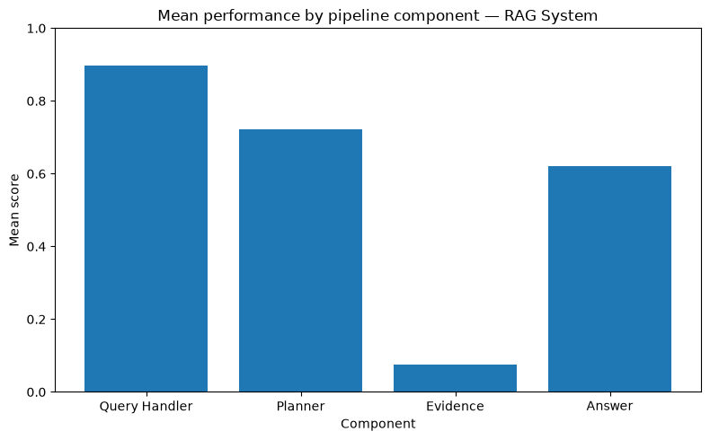

*Figure 7b: Component-Wise Mean Performance Scores for Static Hybrid RAG, demonstrating strong reasoning but severe evidence retrieval bottleneck.*

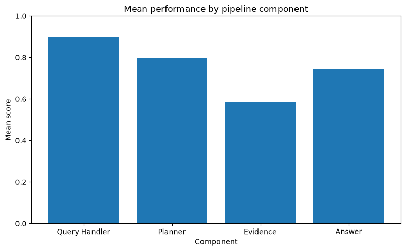

*Figure 7c: Component-Wise Mean Performance Scores for Dynamic Wikipedia Agent, highlighting balanced performance across evidence retrieval and generation.*

---

### 7.3 Evidence Metrics Breakdown by Question Type


*Figure 7d: Static Hybrid RAG Performance Metrics Breakdown across Question Types (Bridge Comparison, Comparison, Compositional, Inference).*

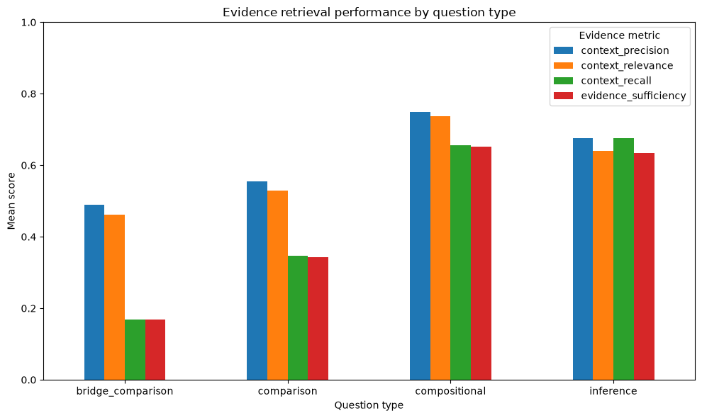

*Figure 7e: Dynamic Wikipedia Agent Evidence Retrieval Performance Breakdown across Question Types.*

#### Deep Analytical Breakdown by Question Category:
* **Compositional & Inference Triumph:** The Wikipedia Agent achieved high context recall (>0.65) and evidence sufficiency (>0.68) on Compositional and Inference queries. In these categories, the Planner's seed queries mapped cleanly to explicit Wikipedia article titles (e.g., *"Sergio Mattarella"* -> *"Sergio Mattarella birthplace"*).
* **Bridge Comparison Bottleneck:** On Bridge Comparison tasks, context recall dropped below **0.20** across both architectures. In bridge queries (e.g., *"Who was born before: the author of The Lord of the Rings or the drummer of The Beatles?"*), localized BM25 chunk filtering, while necessary to control context windows, prematurely discards intermediate "bridge" chunks that lack direct keyword overlap with initial seed queries before neural cross-encoders can evaluate them.

---

### 7.4 End-to-End System Latency Distribution (Seconds)

| Latency Percentile / Metric | Static Hybrid RAG | Dynamic Wikipedia Agent | Latency Factor |
| :--- | :---: | :---: | :---: |
| **Minimum Latency** | **29.60s** | 41.15s | Static RAG 1.4x faster |
| **25th Percentile** | **40.12s** | 95.53s | Static RAG 2.4x faster |
| **50th Percentile (Median)**| **45.75s** | **129.15s** | **Static RAG 2.8x faster** |
| **75th Percentile** | **62.80s** | 205.60s | Static RAG 3.3x faster |
| **90th Percentile** | **632.99s** | Static RAG 5.1x faster |
| **95th Percentile** | **552.31s** | 682.60s | Static RAG 1.2x faster |
| **99th Percentile** | **1020.80s**| 1168.44s | Both encounter long-tail retries |
| **Maximum Latency** | **1052.45s**| **3953.45s** | Extreme link traversal & rate-limit wait |

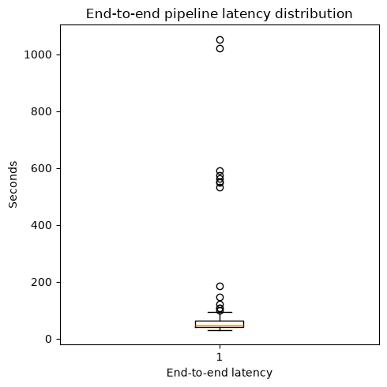

*Figure 7f: Static Hybrid RAG Execution Latency Distribution Box Plot.*


*Figure 7g: Dynamic Wikipedia Agent Execution Latency Distribution Box Plot highlighting median timing (129.15s) and long-tail retries.*

---

## 8. Architectural Compromise: The Agentic RAG Trilemma

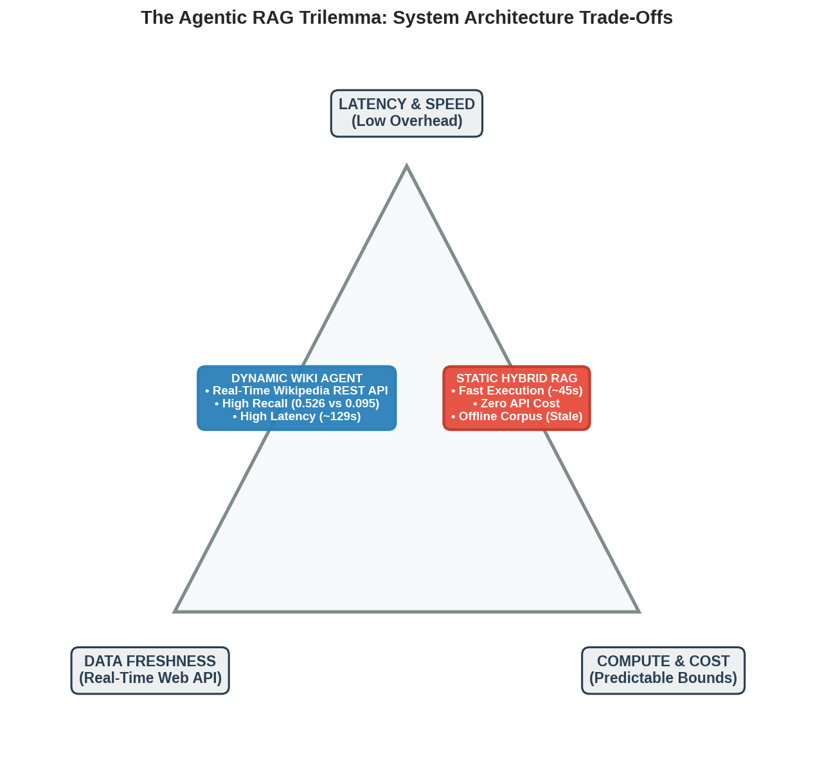

*Figure 8: The Agentic RAG Trilemma trade-off matrix illustrating the core engineering tension between Latency & Speed, Data Freshness, and Compute & Cost Predictability.*

The empirical findings validate the **Agentic RAG Trilemma**: system designers must balance **Latency**, **Compute/Cost**, and **Data Freshness**.

1. **Static Hybrid RAG:** Optimizes for latency (median 45.7s) and zero API cost. However, it suffers from severe **data starvation** when evaluated on open-domain multi-hop benchmarks (Evidence score: 0.075).
2. **Dynamic Wikipedia Agent:** Eliminates data starvation, boosting evidence retrieval to **0.586** and answer correctness to **0.554**. However, adhering to Wikipedia REST API etiquette (sequential scraping, delay timers, exponential backoff) inflates median latency to **129.1s**, with long-tail outliers reaching ~3,953s.

---

## 9. Strengths & Failure Mode Analysis

### Key Strengths

1. **Robust Anti-Hallucination Guardrails:** Both systems maintained high **Answer Faithfulness** (**0.820** for Static, **0.858** for Wiki Agent). Strict prompts anchor LLM outputs strictly to retrieved text.
2. **High Cognitive Efficiency on Local Hardware:** Query Handling (0.898) and Planning (0.796) achieved near theoretical ceilings using a modest **9B local model (Qwen 3.5)**.
3. **Parallelized Hybrid Search:** The Static RAG's `ThreadPoolExecutor` architecture successfully bypasses Python's GIL, achieving parallel FAISS dense and BM25 sparse retrievals.

### Failure Modes & Root Causes

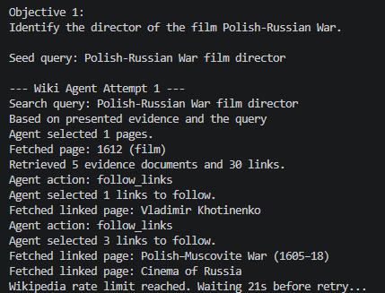

*Figure 9: Execution trace of a single-point-of-failure search cascade on an ambiguous multi-hop entity query, leading to off-target link exploration and rate throttling.*

1. **Wikipedia Search API Single Point of Failure:** The dynamic agent relies entirely on native Wikipedia API search to discover starting pages. Ambiguous query phrasings cause native search to return irrelevant articles, stranding the agent in fruitless link-traversal loops.
2. **Localized BM25 Filtering Loss:** BM25 lexical ranking on live HTML sections occasionally discards subtle semantic "bridge" chunks that lack direct keyword overlap with initial seed queries, reducing Context Recall on Bridge Comparison queries (<0.20).
3. **Static Corpus Data Starvation:** WikiText-103 (~29,558 articles) is far too small for open-domain multi-hop benchmarks, causing Static RAG Context Recall to collapse to 0.051.

---

## 10. Installation & Setup Guide

### 1. Repository Setup

```git clone <repository_url>
cd agentic-ir-wikipedia
python3 -m venv venv
source venv/bin/activate
pip install -r requirements.txt
```

### 2. Local LLM Configuration (LM Studio)

1. Launch **LM Studio**.
2. Download **Qwen 3.5 9B Instruct** (GGUF format, Q4_K_M or Q5_K_M).
3. Enable GPU Acceleration (Vulkan backend).
4. Start Local Server at `http://localhost:1234/v1`.

### 3. Execution Commands

#### Option A: Run Dynamic Wikipedia Agent

```
python main.py --query "Where was the current President of Italy born?"
```

#### Option B: Index Corpus & Run Static Hybrid RAG

```# Build FAISS dense and BM25 sparse indices
python Ingestion/preprocess_wikitext.py
python Ingestion/chunk_and_index.py

# Execute retrieval
python main_rag.py --query "Where was the current President of Italy born?"
```

#### Option C: Run Benchmark & LLM-as-a-Judge Evaluator

```python Evaluation_Agent/benchmark_runner.py --dataset 2WikiMultiHopQA --limit 100
python Evaluation_Agent/ragas_eval.py
```

---

## 11. Future Research & Development Roadmap

1. **Lightweight Local Dense Micro-RAG:** Replace BM25 in localized retrieval with a lightweight local dense embedding model (`bge-micro`) to preserve semantic "bridge" facts during live HTML compression.
2. **Multi-Engine Search Fallbacks:** Equip the dynamic agent with secondary search tools (DuckDuckGo / Tavily API) when native Wikipedia search fails to resolve obscure entities.
3. **Full Offline Wikipedia Dump Indexing:** Rebuild static FAISS and BM25 indices on a full offline Wikipedia dump to evaluate the Static RAG's true logical ceiling without data starvation.
