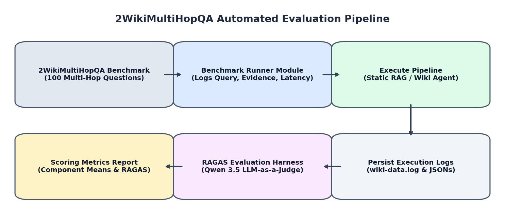
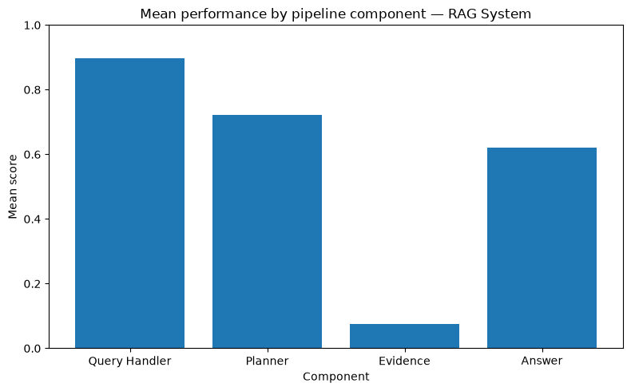
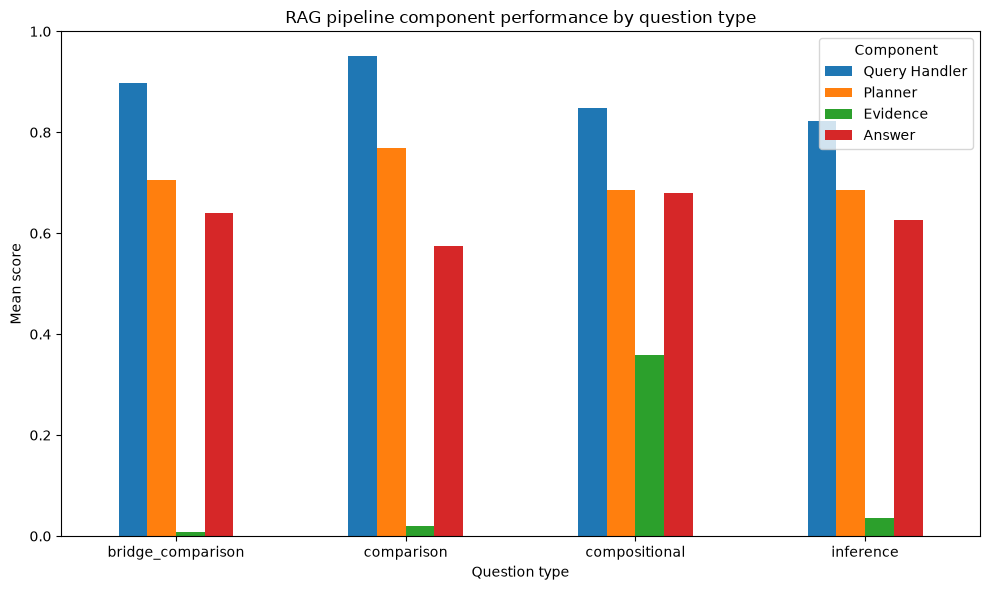
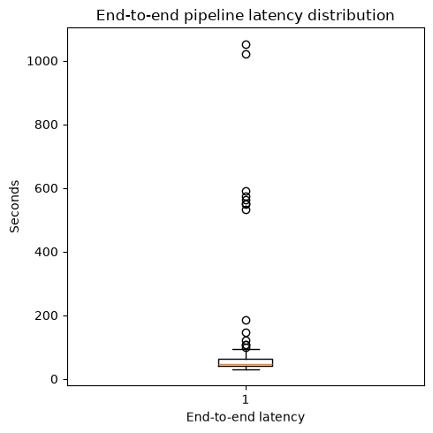
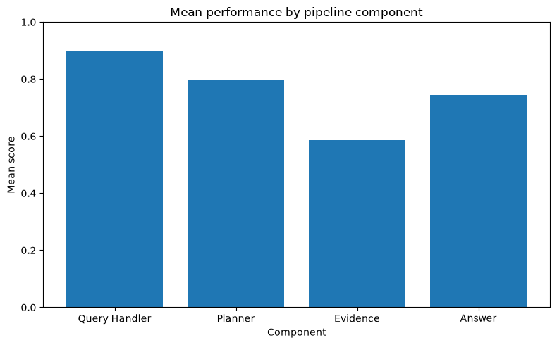
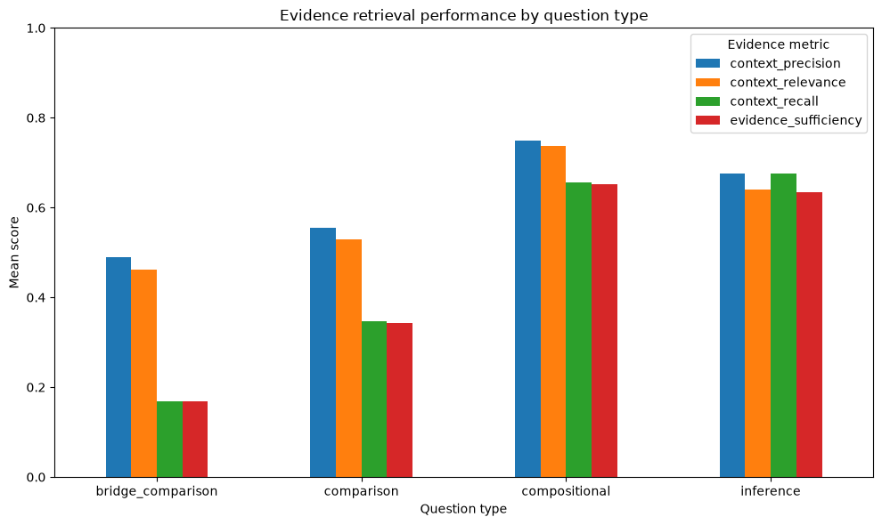
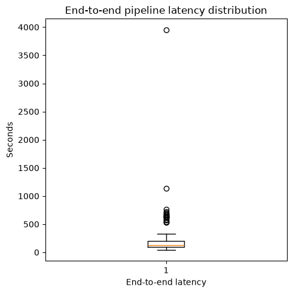
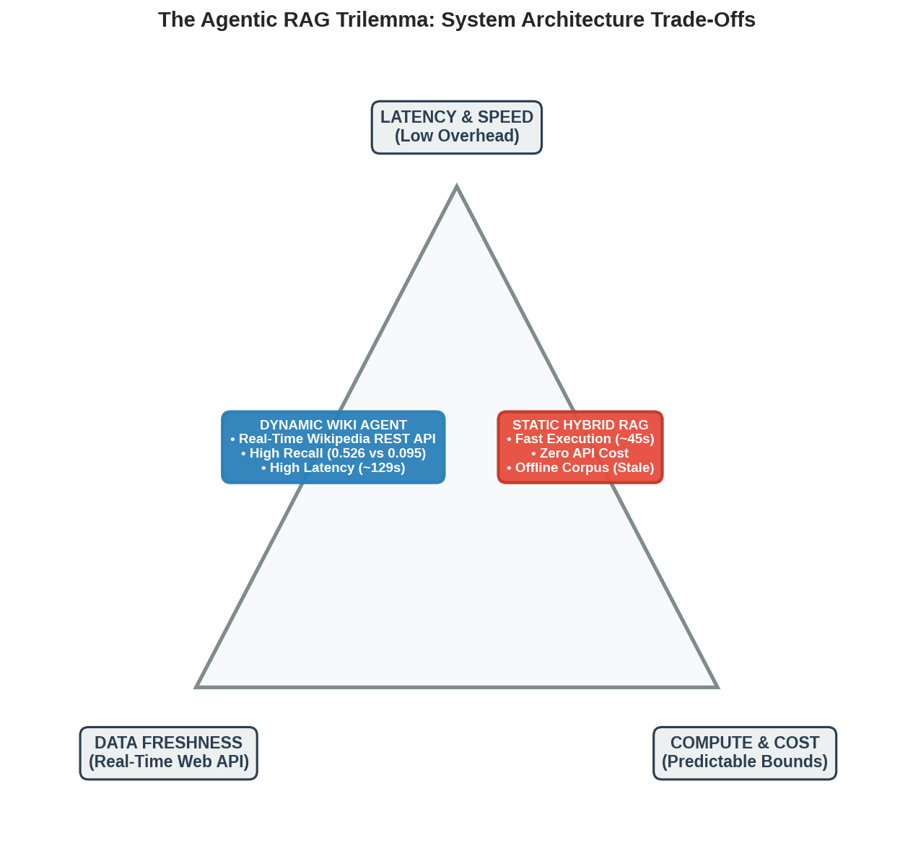
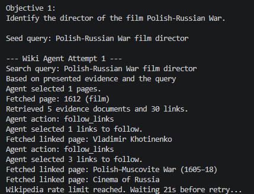
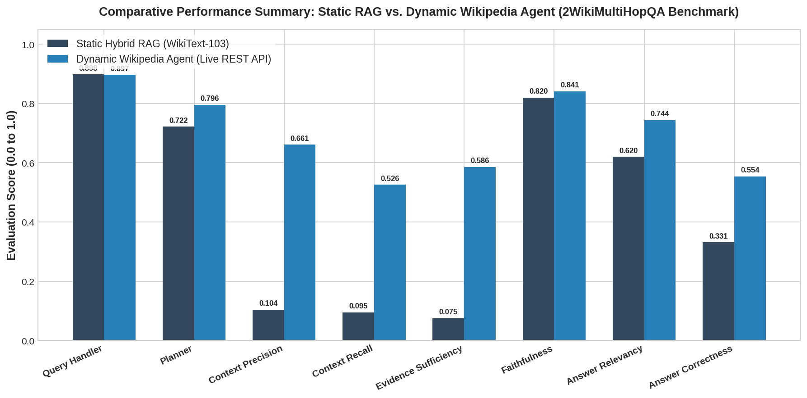

### Agentic AI for Information Retrieval: A Comparative Analysis of Static RAG and Dynamic Wikipedia Crawling Frameworks

#### 1. Introduction

This document presents a comparative empirical evaluation between two Agentic Artificial Intelligence information retrieval systems: a hybrid Retrieval-Augmented Generation (RAG) system operating over a static offline corpus (WikiText-103) and an autonomous dynamic crawling agent interacting with the live Wikipedia REST API. Both architectures utilize a shared cognitive core powered by local LLM orchestration (Qwen 3.5 9B via Vulkan GPU acceleration), incorporating a stateful Query Handler for intent extraction and a DAG Planner for sequential multi-hop strategy formulation.

> **Important Notice for Readers:**  
> This document explicitly focuses **ONLY on the empirical evaluation, benchmark results, metric performance, and comparative analysis** of the static RAG and dynamic Wikipedia agent pipelines. For all project-related details—including full system architecture topology, component design choices, codebase module mapping, local model prompt engineering, and execution/setup instructions—please refer directly to the comprehensive **`README.md`** file.

---

#### Evaluation – LLM-as-a-judge RAGAS inspired evaluation framework
To rigorously evaluate the architecture, we benchmarked the system using the first 100 questions of the 2WikiMultihopQA dataset. Sourced from HuggingFace, this dataset specializes in multi-hop reasoning and provides questions, ground-truth answers, and gold evidence. The dataset challenges the system with four question types:
*   **Bridge Comparison:**  E.g.,  *"Who was born before: the author of The Lord of the Rings or the drummer of the band The Beatles?"*
*   **Comparison:**  E.g.,  *"Which is larger the population of Vienna or the number of people who attended the FIFA World Cup 2022 Finals?"*
*   **Compositional:**  E.g.,  *"Where was the current president of Italy born?"*
*   **Inference:**  Extracting conclusions not explicitly written as a single fact.
The evaluation utilized an LLM-as-a-judge paradigm inspired by RAGAS metrics. The framework scores four distinct areas:
1.  **Query understanding:**  Evaluates intent, entities, concepts, and relationships.
2.  **Planning:**  Evaluates objective decomposition and dependency logic.
3.  **Evidence:**  Evaluates Context Precision (relevance of evidence), Context Recall (how much required information was found), and Evidence Sufficiency.
4.  **Generated answers:**  Evaluates Faithfulness (grounding to evidence), Answer Relevancy, and Answer Correctness against the ground truth.

*Figure 9: Automated 2WikiMultiHopQA Benchmark Execution and LLM-as-a-Judge RAGAS Evaluation Framework Pipeline.*
#### Results - Static RAG
The Static RAG displayed highly competent reasoning but catastrophic retrieval outcomes:
*   **Query Handler:**  0.898
*   **Planner:**  0.722
*   **Evidence Retrieval:**  0.075
*   **Answer Generation:**  0.620
Looking deeper into the metrics, Context Precision was a mere 0.104 and Context Recall was 0.095. Answer Correctness bottomed out at 0.331. The root cause, explicitly visible in the execution logs, is a glaring lack of data. The static WikiText-103 corpus contains fewer than 30,000 articles, which simply did not house the obscure multi-hop facts demanded by the benchmark.
However, a triumph of the system's design is found in the  **Answer Faithfulness**  score of 0.820. This indicates that despite possessing missing or low-quality evidence, the Answer Generation Engine strictly adhered to its anti-hallucination guardrails. When it didn't have the data, it largely refused to guess, resulting in low correctness but high faithfulness to the presented text. In terms of latency, the Static RAG's heavy parallelization allowed it to achieve a rapid median latency of 45.74 seconds (with the bottleneck being the local Qwen 3.5 9B generation speed).

*Figure 10a: Component-Wise Mean Performance Scores for Static Hybrid RAG, demonstrating strong reasoning but severe evidence retrieval bottleneck.*

*Figure 10b: Static RAG Performance Metrics Breakdown across Question Types.*

*Figure 10c: Latency Distribution Box Plot for Static Hybrid RAG System.*
#### Wikipedia Agent
By unleashing the system onto the live internet via the Wikipedia Agent, the results shifted dramatically:
*   **Query Handler:**  0.897
*   **Planner:**  0.796
*   **Evidence Retrieval:**  0.586
*   **Answer Generation:**  0.744
Evidence scores improved nearly 8x over the static system. Context Precision jumped to 0.661 and Context Recall rose to 0.526. Consequently, Answer Correctness improved to 0.554. Breaking down performance by question type, the Wiki Agent excelled at compositional and inference questions. However, its scores on complex Bridge and Comparison questions revealed persistent flaws.
These flaws are heavily tied to the agent's latency. Following strict API etiquette (sequential requests, exponential backoffs) and dealing with network IO caused the median latency to spike to 129.14 seconds, with severe outliers hitting almost 4,000 seconds when the agent became entangled in difficult link explorations or was throttled by Wikipedia rate limits.

*Figure 11a: Component-Wise Mean Performance Scores for Dynamic Wikipedia Agent.*

*Figure 11b: Dynamic Wikipedia Agent Evidence Retrieval Performance by Question Type.*

*Figure 11c: Latency Distribution Box Plot for Dynamic Wikipedia Agent System.*
#### Comparison – Static RAG and Wikipedia Agent
Placing the two systems side-by-side reveals the practical realities of the Agentic RAG Trilemma. The Wikipedia Agent drastically outperforms the Static RAG in Evidence Retrieval (0.586 vs 0.075) and overall Answer Correctness because it possesses the freshness and scope of the live internet. When high-quality evidence is successfully gathered, the system's answer quality scales linearly alongside it.

*Figure 11d: The Agentic RAG Trilemma trade-off matrix illustrating the core engineering tension between Latency & Speed, Data Freshness, and Compute & Cost Predictability.*

However, the Static RAG holds a commanding advantage in Latency (Median 45s vs 129s). The Wiki Agent's performance is ultimately hamstrung by two significant bottlenecks:
1.  **Wikipedia Search Ambiguity:**  If the native API search fails to return valid starting pages for an obscure entity, the agent's entire chain of reasoning collapses.
2.  **Real-time Chunking Bottlenecks:**  The necessity to compress massive HTML pages into top-5 chunks using rapid BM25 scoring occasionally filters out the very facts the agent was looking for, limiting Context Recall to 0.526.

*Figure 11e: Execution trace of a single-point-of-failure search cascade on an ambiguous multi-hop entity query, leading to off-target link exploration and rate throttling.*

*Figure 12: Comprehensive empirical comparison between Static Hybrid RAG and Dynamic Wikipedia Agent across component and end-to-end evaluation metrics.*
#### Conclusion
This project successfully designed and benchmarked two diverse implementations of Agentic AI information retrieval. By moving beyond naive vector search and implementing an autonomous architecture featuring a stateful Query Handler, a DAG-based Planner, and distinct retrieval tools (a parallelized Static Hybrid RAG and a live REST API Wiki Agent), the system demonstrated the capacity to perform complex, multi-hop reasoning.
Through rigorous LLM-as-a-judge evaluation, we observed that the cognitive components of the system (Query Handling, Planning, and Answer Generation) functioned exceptionally well, guided tightly by deterministic Python orchestration and precise few-shot prompting. However, the true determining factor in system success was the quality of the underlying evidence retrieval.
The evaluation clearly highlighted several critical insights:
1.  **Static RAG’s poor evidence retrieval:**  A static RAG is entirely at the mercy of its corpus size and maintenance. The low scores prove a fundamental flaw: no matter how advanced the reasoning agent is, a static system will fail if the underlying data is limited or goes stale.
2.  **Wikipedia Agent’s point of failure:**  While the agent can autonomously rewrite queries and explore links, it is fundamentally bottlenecked by the native Wikipedia search algorithm. If a topic is phrased ambiguously and the external search returns irrelevant results, the agent retrieves the wrong evidence and fails.
3.  **Wiki Agent’s Latency:**  Navigating a live external API demands adherence to strict rate limits and sequential request guidelines. This introduces massive, unpredictable latency spikes, remaining the live agent's greatest shortcoming compared to the lightning-fast parallelized local RAG.
4.  **Anti-Hallucination Guardrails:**  Across both pipelines, despite severe evidence limitations at times, the system maintained high Faithfulness scores, proving that strict instructional prompting successfully anchors LLM output to retrieved text rather than unreliable parametric memory.
#### Future Work
The architectures developed here provide a strong foundation for future optimization:
*   **Static RAG Expansion:**  To accurately benchmark the static RAG's logical ceiling, the FAISS and BM25 indices must be rebuilt utilizing a massive, comprehensive offline corpus (such as the specific Wikipedia dump the 2WikiMultihopQA dataset was derived from).
*   **Improving the Wiki Agent:**  The real-time localized retrieval pipeline currently relies on BM25 for rapid chunk filtering. Replacing this with a lightweight, on-device dense embedding model operating in real-time could vastly improve the semantic preservation of live HTML chunks.
*   **Fallback Capabilities:**  To solve the Wikipedia search API's point-of-failure, future iterations should equip the agent with secondary search tools (like a DuckDuckGo or Tavily web search integration), allowing the agent to cast a wider net when Wikipedia fails to resolve an obscure entity.
